# Go ve Gemini ile Ajan Tasarım Kalıpları (Agentic Design Patterns)

Bu depo, **Go (Golang)** ve **Google Gemini API** kullanılarak çeşitli **Ajan Tasarım Kalıplarının** (Agentic Patterns) uygulanmasını gösterir.

Bu kalıplar, Büyük Dil Modelleri (LLM'ler) ile uygulama mantığı arasındaki etkileşimi yapılandırarak daha güvenilir, ölçeklenebilir ve akıllı yapay zeka sistemlerinin nasıl oluşturulacağını keşfeder.

## ⚠️ Uyarı ve Bilgilendirme

Bu proje tamamen **eğitim ve öğrenme amaçlı** ("Code Kata") hazırlanmıştır.

- **Üretim Ortamı İçin Değildir:** Kodlar, temel tasarım desenlerini (pattern) göstermek için basitleştirilmiştir. Hata yönetimi, güvenlik kontrolleri ve performans optimizasyonları üretim standartlarında olmayabilir.
- **Token Kullanımı:** Örnekler, LLM çağrılarını tekrarlayan döngüler veya büyük bağlam pencereleri (Context Window) kullanabilir. Bu durum, API kotanızın hızlı tükenmesine veya beklenmedik maliyetlere yol açabilir.
- **Hata Payı:** LLM'ler (Gemini dahil) deterministik değildir; yani aynı kodla farklı zamanlarda farklı sonuçlar üretebilirler. Bazen halüsinasyon görebilir veya hatalı kod/yanıt döndürebilirler.
- **Veri Güvenliği:** API anahtarlarınızı asla `git` geçmişine eklemeyin. `.env` dosyalarını `.gitignore` içinde tuttuğunuzdan emin olun.


## 📂 Proje İçeriği ve Mimari

Aşağıda, bu projede yer alan tasarım kalıpları ve işleyiş şemaları bulunmaktadır.

### 1. Prompt Chaining (Zincirleme İstemi)
Karmaşık bir görevi (örneğin blog yazısı yazmak) doğrusal, yönetilebilir adımlara böler. Bir adımın çıktısı, diğerinin girdisi olur.

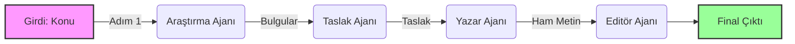

---

### 2. Routing (Yönlendirme)
Gelen kullanıcı isteğini analiz eder ve en uygun işleyiciye (veya modele) yönlendirir.

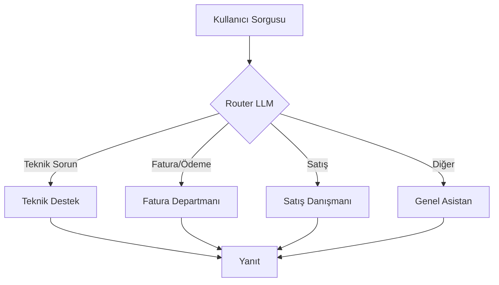

---

### 3. Parallelization (Paralelleştirme)
Bir görevi bağımsız parçalara ayırır, bunları aynı anda (concurrent) işler ve sonuçları birleştirir.

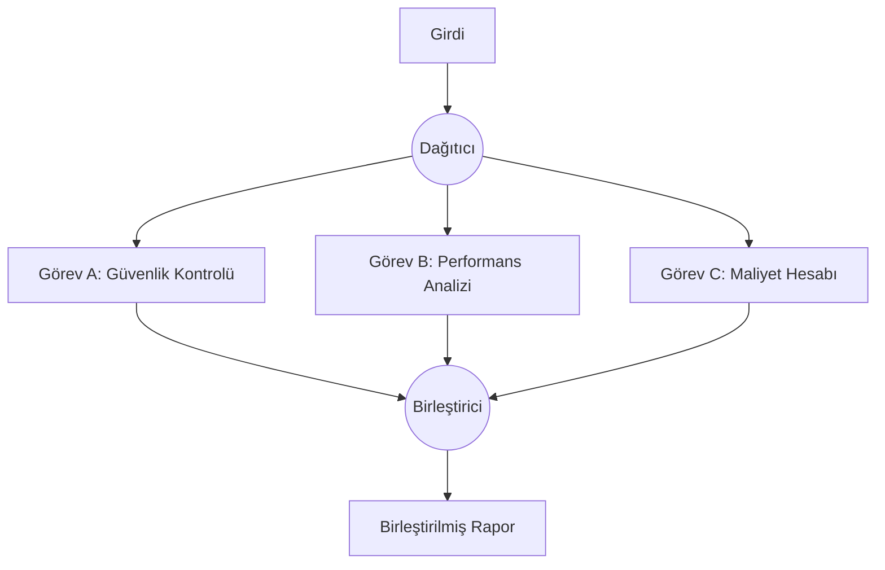

### 4. Reflection (Düşünme/İyileştirme)
Modelin kendi ürettiği çıktıyı eleştirmesini ve hataları düzelterek yeniden üretmesini sağlar (Self-Correction).

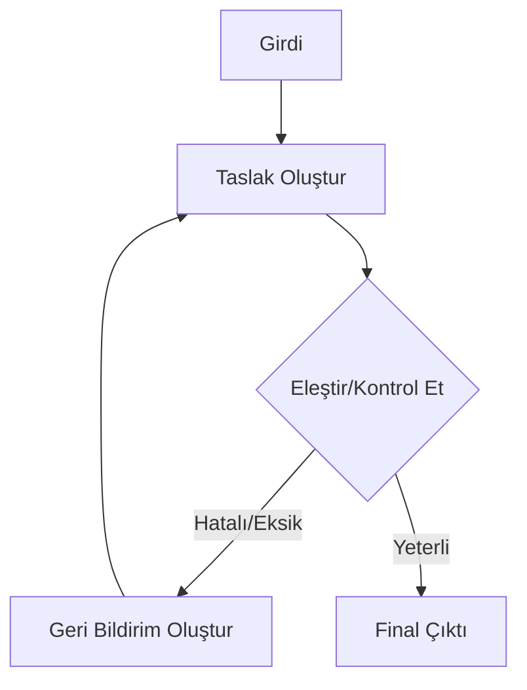

---

### 5. Tool Use (Araç Kullanımı)
Modelin kendi bilgisi dışındaki verilere erişmesi veya eylem gerçekleştirmesi için harici fonksiyonları çağırmasıdır.

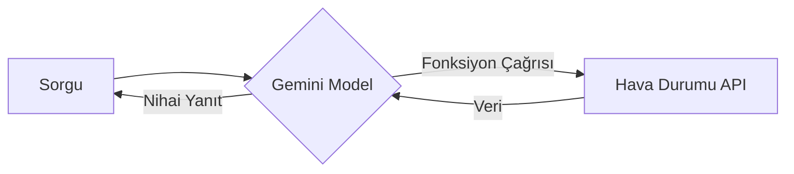

---

### 6. Planning (Planlama)
Model, görevi doğrudan yapmak yerine önce adım adım bir plan hazırlar, sonra bu planı sırasıyla uygular.

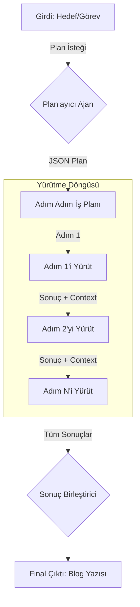

---

### 7. Multi-Agent Collaboration (Çoklu Ajan İşbirliği)
Farklı uzmanlıklara sahip ajanların bir koordinatör yönetiminde ortak bir amacı gerçekleştirmesidir.

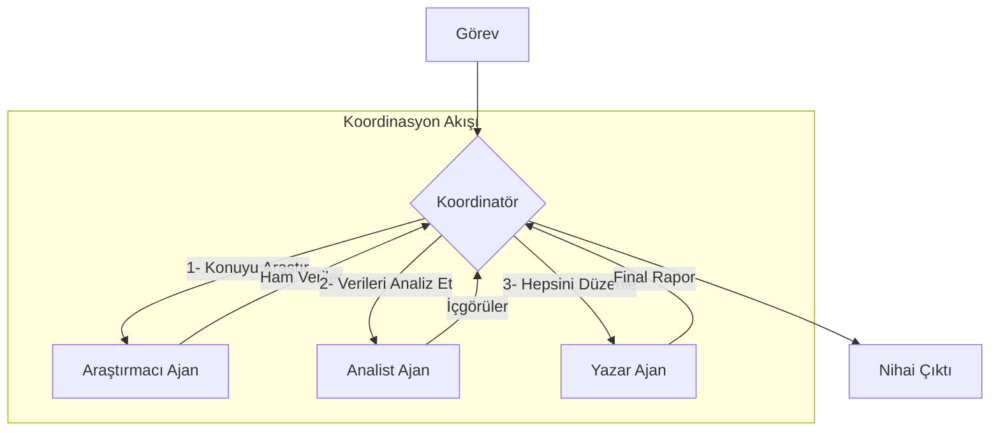

---

### 8. Memory Management (Bellek Yönetimi)
Müşteri etkileşimlerini, tercihlerini ve geçmiş konuşmaları saklayarak bağlam farkındalığı sağlar. Kişiselleştirilmiş yanıtlar üretmek için geçmiş bilgileri kullanır.

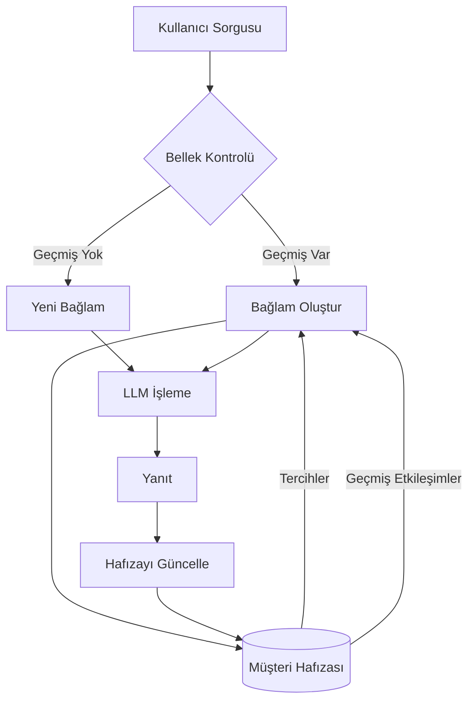

---

### 9. Advanced Memory Management (Gelişmiş Bellek Yönetimi)
Embedding tabanlı benzerlik araması, farklı bellek türleri (kısa/uzun vadeli, episodik, semantik, prosedürel) ve otomatik bellek birleştirme ile gelişmiş hafıza yönetimi sunar.

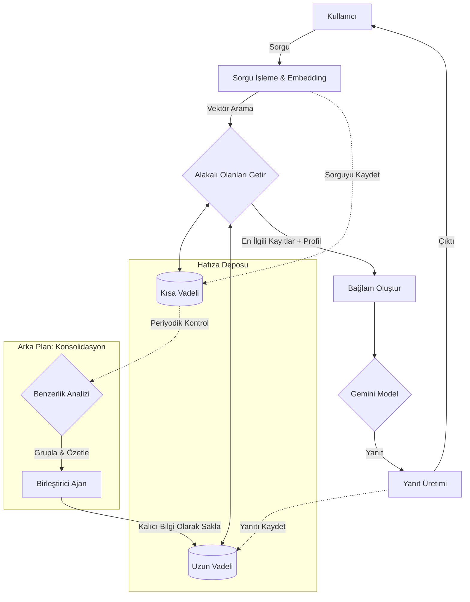

---

### 10. Learning and Adaptation (Öğrenme ve Adaptasyon)
RAG (Retrieval-Augmented Generation), Memory-Based Learning ve Online Learning tekniklerini birleştirerek sürekli öğrenen ve adapte olan bir AI sistemi. Müşteri etkileşimlerinden öğrenir, bilgi tabanını dinamik olarak günceller ve kişiselleştirilmiş yanıtlar üretir.

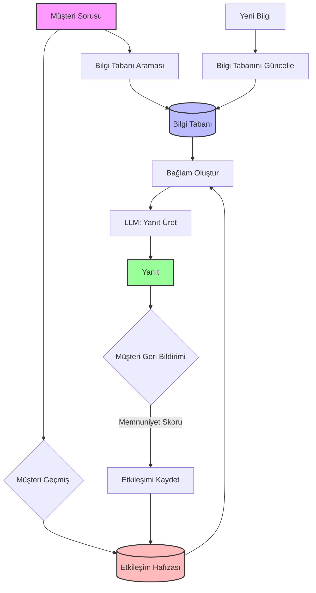

---

### 11. Model Context Protocol (MCP) (Model Bağlam Protokolü)
Yapay zeka modellerini harici veri kaynaklarına (Resources) ve araçlara (Tools) standartlaştırılmış, bağımsız bir protokol üzerinden bağlar. Bu, güvenlik sınırlarını korumanızı ve modüler bir mimari kurmanızı sağlar.

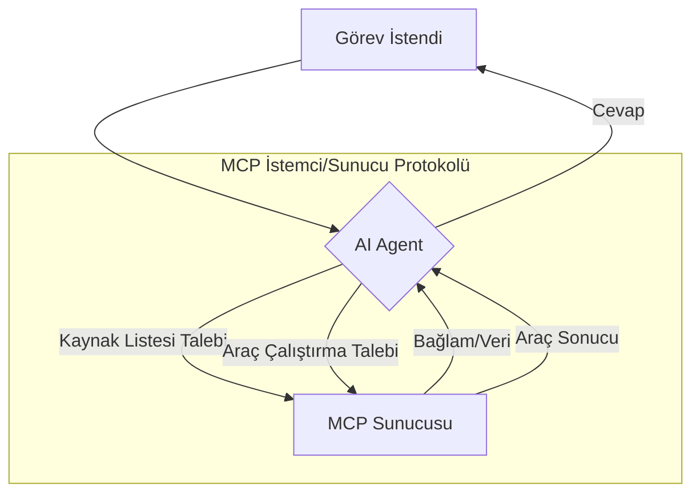

---

## 🚀 Başlarken

### Gereksinimler

- **Go 1.25** veya üzeri
- Bir **Google Gemini API Anahtarı** ([aistudio.google.com](https://aistudio.google.com/) adresinden alabilirsiniz)

### Kurulum

1.  **Depoyu klonlayın:**
    ```bash
    git clone https://github.com/kullaniciadiniz/agentic-design-patterns.git
    cd agentic-design-patterns
    ```

2.  **Bağımlılıkları yükleyin:**
    ```bash
    go mod download
    ```

3.  **Ortam Değişkenlerini Ayarlayın:**
    Kök dizinde `.env` dosyası oluşturun:
    ```bash
    cp .env.example .env
    ```
    Ve içine API anahtarınızı yapıştırın:
    ```env
    GOOGLE_API_KEY=AIzaSy...
    GEMINI_MODEL=gemini-2.0-flash-exp
    ```

## 🏃‍♂️ Kullanım (Makefile ile)

Projeyi kolayca çalıştırmak için `make` komutlarını kullanabilirsiniz:

```bash
make help                # Tüm komutları listeler
make run-chain           # Prompt Chaining desenini çalıştırır
make run-routing         # Routing desenini çalıştırır
make run-parallel        # Parallelization desenini çalıştırır
```

Veya doğrudan Go komutu ile:

```bash
go run 01-prompt-chaining-pattern/main.go
```

## 🛠️ Kullanılan Teknolojiler

- **Go** (Golang)
- **Google Generative AI Go SDK**
- **Mermaid.js** (Diyagramlar için)

